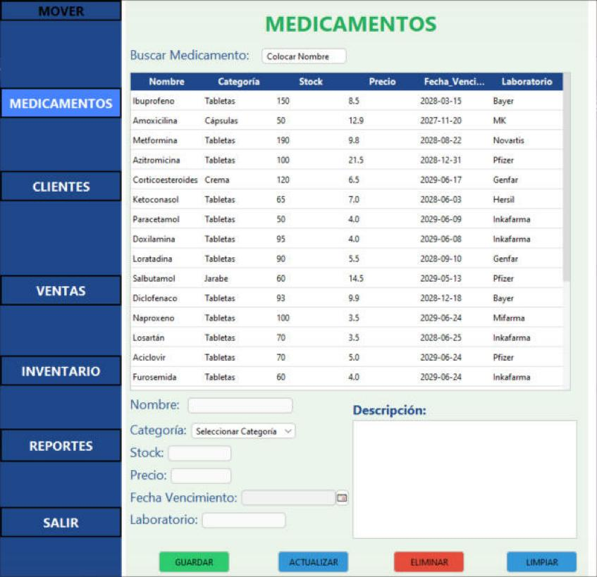
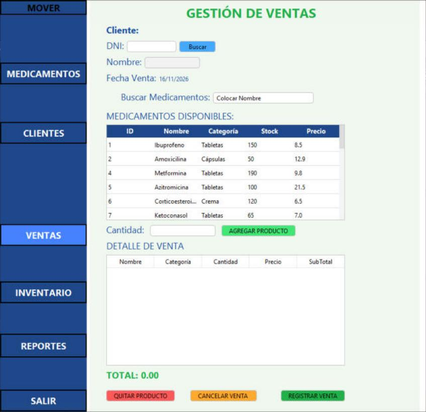
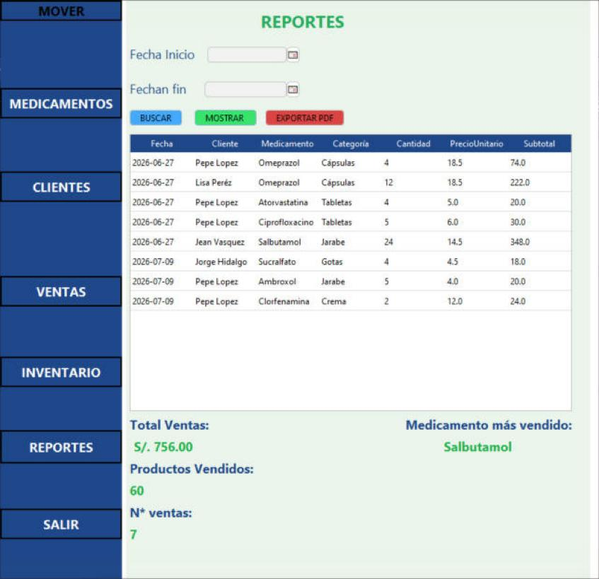

# Sistema de Gestión Farmacéutica

Aplicación de escritorio para llevar las ventas, el inventario y los clientes de una farmacia. Proyecto académico del curso de Programación Orientada a Objetos (Ingeniería de Sistemas, Universidad Privada del Norte).

> Proyecto con fines educativos. No está afiliado a ninguna empresa; los nombres y logotipos que aparecen se usaron solo como caso de estudio.

## Capturas

| Medicamentos | Ventas | Reportes |
|---|---|---|
|  |  |  |

Los datos que aparecen son de prueba.

## Qué hace

- **Inicio de sesión** con usuario y contraseña cifrada.
- **Medicamentos:** registrar, buscar, actualizar y eliminar, con categoría, laboratorio, precio, stock y fecha de vencimiento. La eliminación es lógica (por estado), así que no se pierde el historial.
- **Inventario:** registro de entradas de stock con motivo, y consulta de los movimientos de cada medicamento.
- **Ventas:** búsqueda de medicamentos disponibles, detalle de venta con varios productos, cliente por DNI, cálculo del total y descuento automático del stock.
- **Clientes:** registro, búsqueda, actualización y eliminación.
- **Reportes:** total vendido, número de ventas, productos vendidos y medicamento más vendido, en general o entre dos fechas, con **exportación a PDF**.
- **Validaciones** de datos en todos los formularios.

## Tecnologías

| Parte | Tecnología |
|---|---|
| Lenguaje | Java |
| Interfaz | Swing (NetBeans GUI Builder) con FlatLaf |
| Base de datos | Microsoft SQL Server, por JDBC |
| Reportes PDF | iText 5 |
| Selector de fechas | JCalendar |
| Compilación | Apache Ant (proyecto NetBeans) |

## Estructura

```
src/
  conexion/     Conexión a SQL Server
  seguridad/    Cifrado y verificación de contraseñas
  Modelo/       Clases del dominio: Medicamento, Cliente, Ventas, DetalleVenta, MovimientoInventario...
  DAO/          Acceso a datos: una clase por entidad, más los reportes
  hesilfarma/   Ventanas: login, menú, medicamentos, inventario, ventas, clientes, reportes
ScriptsBaseDeDatos/   Scripts SQL para crear las tablas
DataBase/             Copia de seguridad de la base de datos (.bak)
lib/ y calen/         Librerías: driver JDBC, iText, FlatLaf, JCalendar
docs/                 Capturas de pantalla
```

El código separa el modelo, el acceso a datos (patrón DAO) y las ventanas.

## Cómo ejecutarlo

1. Instala JDK 26 (la versión con la que está configurado el proyecto), NetBeans y SQL Server.
2. Crea la base de datos de una de estas dos formas:
   - restaura `DataBase/backup.bak` desde SQL Server Management Studio, o
   - crea una base de datos vacía y ejecuta los scripts de `ScriptsBaseDeDatos/`.
3. Copia `config.example.properties` como `config.properties` y pon ahí el servidor, el puerto, el usuario y la contraseña de tu SQL Server.
4. Abre la carpeta como proyecto en NetBeans y ejecútalo (F6).
5. Entra con el usuario de demostración: usuario `demo`, contraseña `demo1234`.

## Seguridad

- **Datos de conexión fuera del código:** se leen de `config.properties`, que está en `.gitignore` y no se sube al repositorio.
- **Contraseñas cifradas:** `usuarios.txt` no guarda contraseñas, sino su resumen con PBKDF2 (HMAC-SHA256) y sal aleatoria. La lógica está en `src/seguridad/Claves.java`.
- **Usuarios nuevos:** ejecuta la clase `seguridad.Claves` con el usuario y la contraseña como argumentos, y copia la línea que imprime a `usuarios.txt`.

Las primeras versiones del proyecto guardaban estos datos en texto plano; se corrigió después y el historial de commits conserva ese cambio.

## Autor

Desarrollado como proyecto universitario en 2026.
